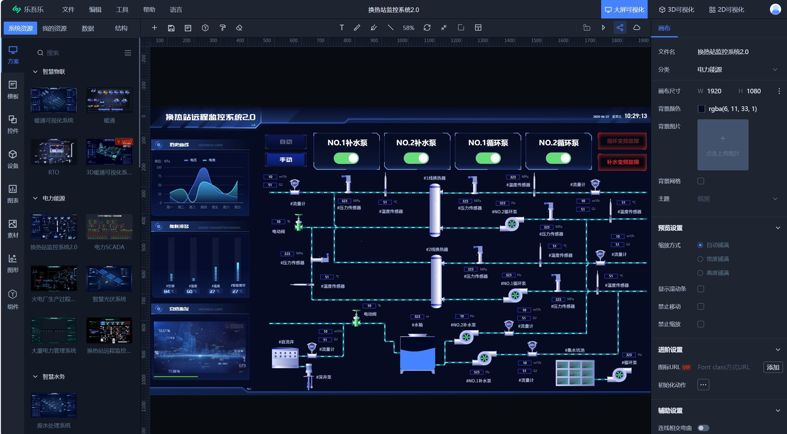
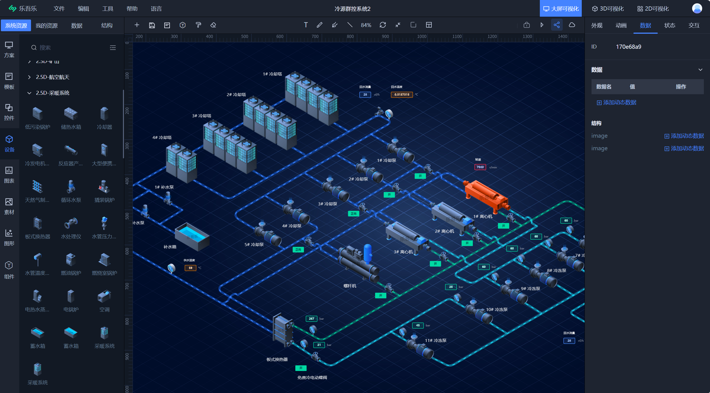
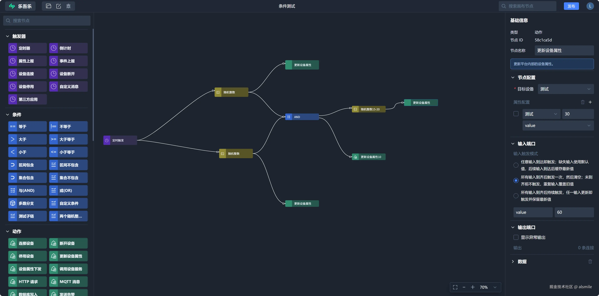

[简体中文](./README.md) | English

# Meta2d.js

Meta2d.js is a 2D visualization engine built around **data-driven display** and **dynamic interaction**. It covers drawing, animation, messages, events, real-time data communication, conditional alarms, lifecycle hooks, custom shapes and extensions. You can use it to build web SCADA/HMI, reports, flowcharts, control-room dashboards and similar visualizations.

<center style="display:flex;justify-content:center">





</center>

<br>

# Online demo

[Try it online (Le5le Dashboard)](http://v.le5le.com)

<br>

# Features

**Philosophy**

- Data + algorithms + style = lifelike visuals
- Data-driven display
- Driven by real-time data
- Dynamic, interactive, fully controllable
- Lifecycle management, flexible control
- Extensible and customizable
- Simple, yet capable

**Real-time data communication**

- Multiple protocols: MQTT, WebSocket, HTTP, SSE and more
- Simple data point binding
- Send commands back to devices

**Real-time monitoring and conditional alarms**

- Lifecycle functions
- Watch data with relational conditions
- Watch data with custom conditions
- Trigger actions on conditions

**Rich interaction events**

- Mouse events
- Built-in system messages
- Custom messages
- Move, resize, rotate and other events
- Animation and video playback events
- Form input

**Native Web Component**

- Built as a native Web Component
- Isolated and self-contained
- Multiple instances, easy to reuse

**Performance**

- Multi-threaded, partial rendering
- 100,000+ nodes
- 1,000+ real-time data points, with room to spare for large and demanding workloads
- 400+ simultaneous animations that stay smooth

| Pens      | FPS       | Memory (MB) | Notes                                 |
| --------- | --------- | ----------- | ------------------------------------- |
| 10,000    | 117 - 120 | 44 - 50     | Dragging and zooming unaffected       |
| 100,000   | 114 - 120 | 80 - 110    | No frame drops during mouse picking   |
| 1,000,000 | 109 - 117 | 510 - 840   | No frame drops during mouse picking   |

Benchmark: examples/benchmark  
Environment: 8-core 3.8GHz CPU, 32GB RAM  
Load: 200 images, 2,000 data points, 400 animations

**Extensible**

- Custom shape libraries
- Free composition
- Plugin extensions such as lifecycle functions and layouts

<br>

# Installation

```
# npm
$ npm install @meta2d/core @meta2d/extension --save

# yarn
$ yarn add @meta2d/core @meta2d/extension

# pnpm
$ pnpm add @meta2d/core @meta2d/extension
```

# Quick start

1. Add the le5le-meta2d web component to your HTML

```
  <body>
    <le5le-meta2d></le5le-meta2d>
  </body>
```

2. Create the le5le-meta2d instance in JS

```
import { createMeta2d, Mode } from '@meta2d/core';

createMeta2d();

const meta2d = document.querySelector('le5le-meta2d');
meta2d.setMode(Mode.Edit); // Edit mode. The default is run mode
meta2d.setOptions(...); // Optional

fetch('your-data.json')
  .then((res) => res.json())
  .then((data) => {
    meta2d.open(data);
  });
```

<br>

# Documentation

[Documentation](docs/README.en-US.md)

<br>

# Application: Diagram Flow

Diagram Flow (diagram-flow) is a creative drawing and design tool built on Meta2d.js for architecture diagrams, flowcharts, mind maps, charts and other interactive 2D graphics.

## Run locally

```
# Install dependencies in the repo root
pnpm/npm install

# Enter the diagram-flow directory
cd diagram-flow
pnpm/npm start
```

# License

MIT © le5le.com
